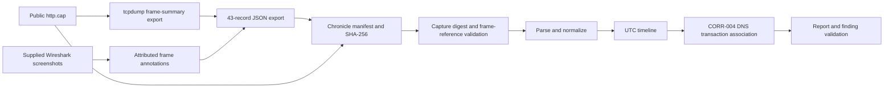
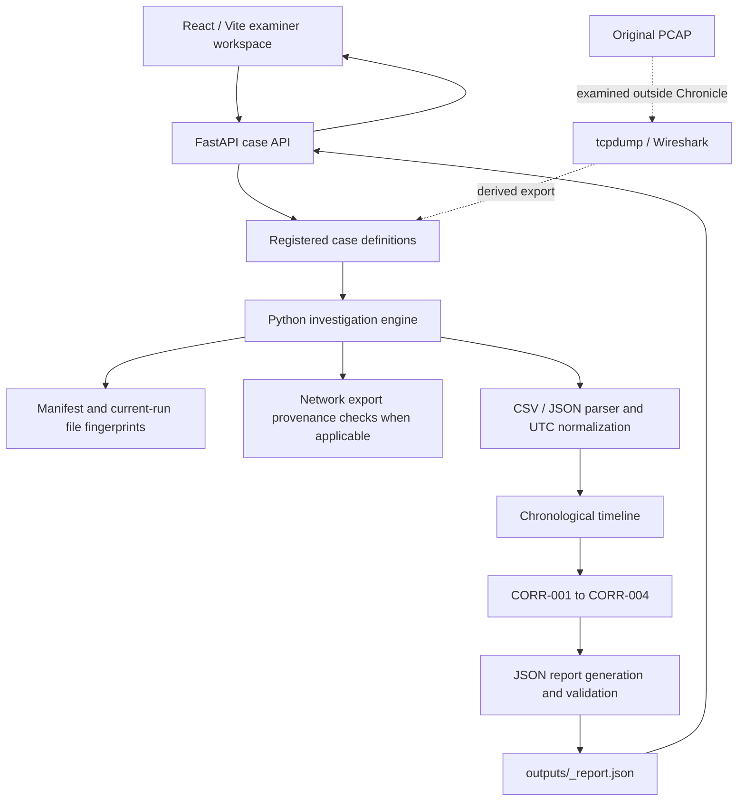

# Chronicle — Digital Forensic Investigation and User Attribution

Chronicle is an academic forensic investigation workbench built around **evidence intake, integrity, examination, source-linked timelines, explainable correlations, and cautious reporting**. Its primary walkthrough now examines Shreya’s supplied public Wireshark practice capture. Two separate synthetic cases remain available for controlled testing and regression.

> **Evidence boundary:** `WIRESHARK-PRACTICE-001` uses a public sample capture, not evidence acquired from a real incident. It shows ordinary HTTP and DNS activity and supports no claim of malicious activity, exfiltration, or human attribution. Operation Glasshouse and `CHRONICLE-DEMO-001` are separate synthetic cases. C-001 is a separate fictional exhibit context.

## Chronicle’s primary investigation

Select **HTTP Capture Practice Examination**, run it, then inspect the evidence ledger, packet observation table, timeline, DNS correlation, and report. Chronicle processes a reproducible JSON export created with `tcpdump`; Wireshark performs the screenshot-documented filtering and supplies separately attributed annotations. Each exported observation keeps its stable event ID, capture digest, frame number, timestamp, endpoints, extraction tool, and source-record reference.

The current result is deliberately modest: a client requests an Ethereal download page, resolves an advertising hostname, and receives HTTP responses. The available evidence does not identify a person or establish an incident. The DNS query/response match is a protocol-level association, not a security verdict.

## Cases and boundaries

| Track | Case | Demonstrates |
|---|---|---|
| **Primary** | `WIRESHARK-PRACTICE-001` | 43 observations derived from Shreya’s public `http.cap`; frame-linked evidence, hash comparison to the export, HTTP/DNS timeline, and a DNS transaction correlation. |
| Supporting synthetic validation | `OPERATION-GLASSHOUSE` | 240 generated authentication, endpoint, and network-log records; three correlation rules produce 15 leads, including a suspicious-looking and a benign backup sequence. A fourth DNS rule is evaluated and has no matches. |
| Legacy regression | `CHRONICLE-DEMO-001` | The original six synthetic events remain available and independently selectable. |

The public PCAP is not merged with Glasshouse or C-001. The Autopsy screenshot is a separate C-001 visual exhibit; the repository has no disk image, Autopsy case database, or structured filesystem export. Chronicle does not perform Autopsy analysis or directly parse PCAP payloads.

## Investigation flow



The API also runs the synthetic cases through the same manifest, parser, timeline, correlation, report, and validation components. Their inputs and findings remain case-specific.

## Architecture



Details and case separation are documented in [the architecture](docs/ARCHITECTURE.md), [the network examination](docs/case-study-network-practice.md), [evidence provenance](docs/evidence-provenance.md), and [the correlation rules](docs/correlation-rules.md).

## Verified results

Results from the latest local checks in this repository:

| Check | Result |
|---|---:|
| Primary packet observations | 43 stable frame-linked records |
| Wireshark screenshot annotations | HTTP frames 4, 18, 27, 38; DNS frames 13, 17 |
| Primary-case findings | 1 DNS query/response association, informational only |
| Glasshouse | 240 synthetic events; 15 leads across 4 evaluated rules (3 rules matched) |
| Legacy case | Original six-event fixture preserved |
| Python unit tests | 50 passed |
| Vite production build | Passed |

Unit tests and synthetic scenario checks validate implemented software behavior; they do not measure real-world forensic accuracy.

## Run locally

Requirements: Python 3.11+, Node.js 20+, and `tcpdump` to regenerate the network export. The checked-in export can be examined without rerunning the extractor. No credentials or hosted services are required.

### Install dependencies

```bash
python3 -m venv .venv
source .venv/bin/activate
python -m pip install -r requirements.txt
cd frontend && npm install
```

### Start Chronicle

Terminal 1, from the repository root:

```bash
.venv/bin/uvicorn src.api:app --host 127.0.0.1 --port 8000
```

Terminal 2:

```bash
cd frontend
npm run dev -- --host 127.0.0.1
```

Open <http://127.0.0.1:5173>. The default selection is the primary network-practice case. Choose **Run investigation**; switch cases from the selector when needed. API health check: <http://127.0.0.1:8000/api/health>.

### Reproduce the packet observation export

From the repository root, with `tcpdump` available:

```bash
.venv/bin/python data/extract_http_cap.py
```

This writes `data/cases/wireshark-practice/http-cap-observations.json` from the unchanged PCAP. It does not use a third-party Python packet parser. The method, tool version, digest, decoder differences, and time-zone limitations are recorded in the export and [case study](docs/case-study-network-practice.md).

### Reproduce synthetic data and checks

```bash
.venv/bin/python data/generate_glasshouse.py
.venv/bin/python evaluation/run_evaluation.py
cd frontend && npm run build
```

The evaluation runner executes `tests/test_*.py` and writes an ignored machine-readable result to `outputs/evaluation_report.json` and a readable summary to `docs/evaluation-report.md`. It is not a real-world detection benchmark.

## Evidence integrity and interpretation

Chronicle fingerprints the files present during the current run. In the network case it compares the capture’s current digest with the digest recorded in the derived export and validates frame references. This does not prove historical authenticity, acquisition integrity, or chain of custody. Each finding links supporting event IDs and original source references; correlations are leads, not proof of identity, intent, or causation.

The source capture is 25,803 bytes and has SHA-256 `25a72bdf10339f2c29916920c8b9501d294923108de8f29b19aba7cc001ab60d`. The Autopsy screenshot is 107,722 bytes and has SHA-256 `52d4ad309a391ef4d759689c9cfcf9ee8991a002b5387ee499e1e8ce3408a7e4`; it shows only a synthetic note exhibit. No supporting disk image or structured Autopsy source is present.

## Repository guide

| Path | Purpose |
|---|---|
| `src/` | FastAPI API, case registry, engine, parser, hashing, timeline, correlation, reporting |
| `data/extract_http_cap.py` | Reproducible tcpdump-to-JSON packet-summary exporter |
| `data/cases/wireshark-practice/` | Derived 43-frame network observation export |
| `data/cases/operation-glasshouse/` | Reproducible 240-event synthetic case |
| `data/raw/` | Original six-event regression fixture |
| `data/evaluation/` | Separate Glasshouse generator-intent labels |
| `evidence/` | Original public sample, supplied screenshots, and separate synthetic C-001 note |
| `frontend/` | React/Vite examiner interface and static copies of supplied exhibits |
| `tests/`, `evaluation/` | Automated checks and runner |
| `docs/` | Case, provenance, workflow, architecture, evaluation, and demo documentation |
| `outputs/` | Local generated reports and evaluation JSON; ignored by Git |

## Screenshots and recording

The checked-in images are supplied Wireshark/Autopsy exhibits, not Chronicle application screenshots. Use the exact screen names in [the screenshot checklist](screenshots/README.md) to capture the real application during the recording setup. Follow [docs/demo-script.md](docs/demo-script.md) for a 7–8 minute group walkthrough.

## Team

The team is Neil, Shreya, and Aarohi. Shreya’s confirmed contribution includes the public Wireshark practice capture, HTTP/DNS screenshots and notes, the Autopsy screenshot, and incident/evidence-integrity materials. Aarohi is acknowledged as a team member; no unconfirmed component contribution is assigned. See [team contributions](docs/team-contributions.md).

## Limitations

- Chronicle consumes the checked-in network observation export; it does not natively decode PCAP or reconstruct TCP streams.
- Wireshark annotations are screenshot-derived and explicitly labeled; decoder differences are documented.
- No disk image, Autopsy case database, or structured filesystem export is available.
- No trusted acquisition-time hash baseline, chain-of-custody log, general evidence upload, or arbitrary case-registration workflow exists.
- Glasshouse records and its ground-truth labels are synthetic. The labels are not used by the analyzer.
- The parser stops on malformed input instead of quarantining individual rows.

This is a limited Cyber Forensics & Laws academic demonstration, not a commercial forensic suite or a real incident report.
