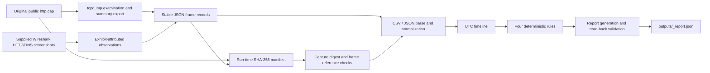

# Chronicle architecture

## Network examination data flow

`data/extract_http_cap.py` invokes `tcpdump` on the original PCAP. It creates one stable observation per frame, retains the raw epoch value and normalized UTC timestamp, endpoint fields, decoded summary, tool version, capture digest, frame reference, and export-record reference. The script also records selected Wireshark screenshot annotations separately from tcpdump's per-frame decoding. It does not reconstruct entire TCP streams.

The API and engine do not execute tcpdump during an investigation run. They fingerprint the original PCAP and derived JSON export, parse the export, and verify that each exported record refers to the current capture digest and a unique in-range frame. Reports include the examination method, decoder caveat, source references, and limitations.

## Registered cases

- `WIRESHARK-PRACTICE-001` — primary public sample network examination; source PCAP is `evidence/captures/http.cap`, imported event export is `data/cases/wireshark-practice/http-cap-observations.json`.
- `OPERATION-GLASSHOUSE` — 240 fabricated events in CSV, with separate generator-intent labels.
- `CHRONICLE-DEMO-001` — retained six-row fabricated regression case.

The case registry in `src/cases.py` keeps inputs, scope, provenance, and metadata separate. Generated reports are written as `outputs/<case-id>_report.json`; API routes in `src/api.py` serve the selected case's report.

## Processing and validation

`src/engine.py` calculates a current-run manifest, parses and normalizes event inputs, optionally validates packet provenance, sorts the timeline, runs the four documented rules in `src/correlation.py`, generates the report, checks event/source references, and reads the serialized report back. Processing durations are measured during the run.

The default hash operation fingerprints the current file. In the network case only, Chronicle compares the PCAP digest against the digest embedded in its export. Neither proves earlier authenticity or custody. The Glasshouse ground-truth fixture is not read by the analyzer.

## Frontend and API

The React/Vite application uses `/api/cases`, `/api/investigate/{case_id}`, `/api/report?case_id=...`, and `/api/evaluation`. It displays the case-specific report and allows navigation from finding event IDs to timeline/packet records. It does not upload or modify source evidence. Static PCAP and screenshot copies under `frontend/public/evidence/` were verified to match the originals by SHA-256.

## Case boundaries

- Public practice capture observations do not belong to C-001 or Glasshouse.
- The Autopsy screenshot is only a C-001 visual exhibit. No disk image, structured export, or Autopsy case database was found; Chronicle did not conduct an Autopsy examination.
- Glasshouse's network rows are synthetic proxy-style records; no PCAP is used in that case.
